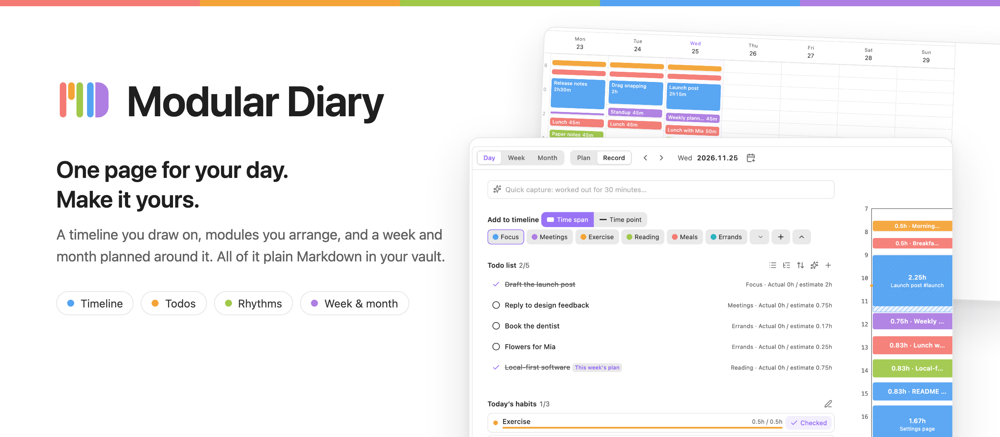
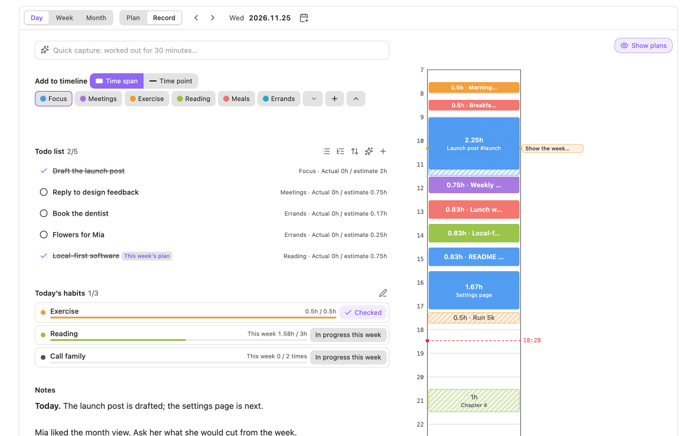
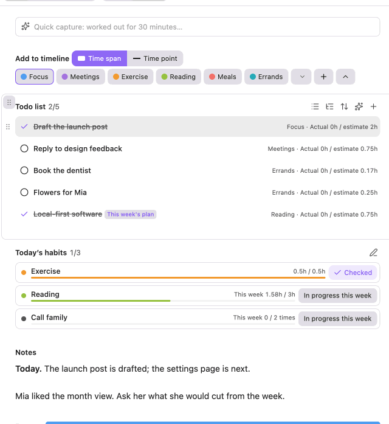
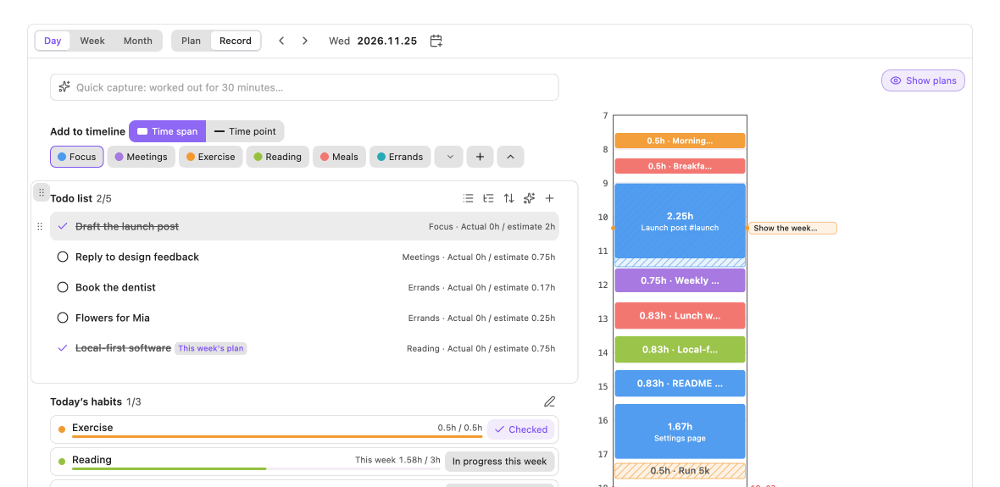
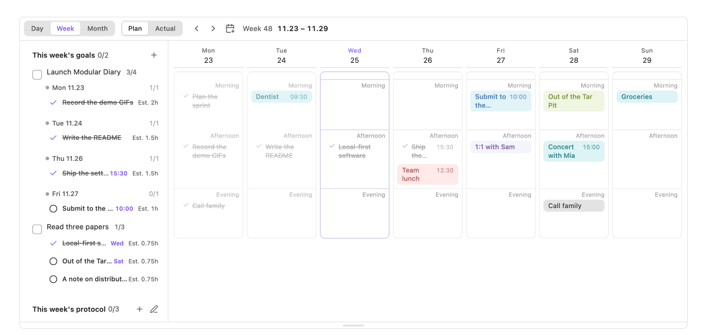
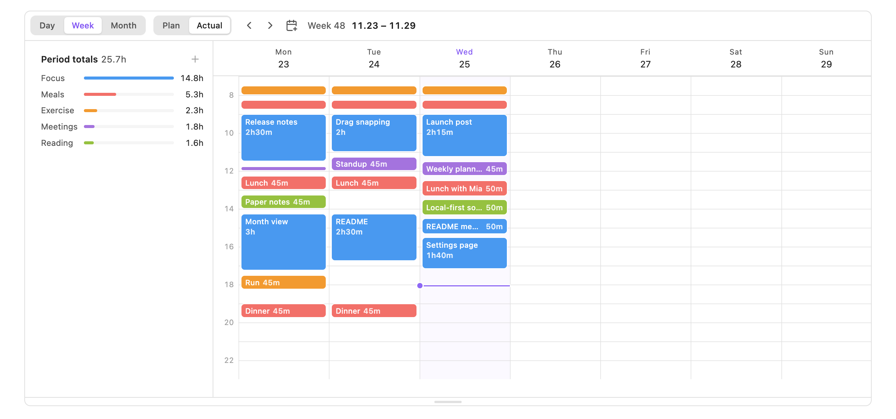
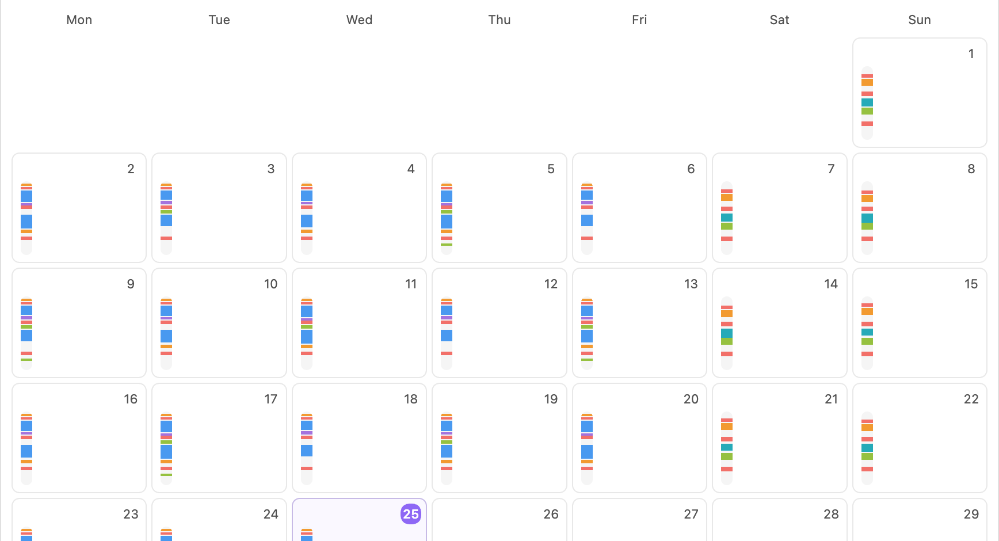

<p align="center">
  
</p>

<p align="center">
  <a href="https://community.obsidian.md/plugins/modular-diary"></a>
  <a href="https://github.com/IvyYang1999/modular-diary/releases/latest"></a>
  <a href="https://github.com/IvyYang1999/modular-diary/releases"></a>
  
</p>

<p align="center">
  <a href="https://community.obsidian.md/plugins/modular-diary"><b>Install in Obsidian</b></a> ·
  <a href="https://modular-diary.yytyyf.com/en/">Website</a> ·
  <a href="#中文">中文说明 ↓</a>
</p>

<p align="center">
  
</p>

## What it does

**A timeline you draw on.** Pick a category and drag on the day's hour axis: that is a block of time, its length written in. Plans are hatched, records are solid, and what actually happened sits over what you planned. Drag a todo onto the timeline and it becomes a plan as long as its estimate. A thin line marks the current time.

**Modules, laid out your way.** Quick capture, todos, habits, notes, time stats, checklists, a daily quote, an hour-by-hour log: add the ones you use. Grab a module by its grip to move it, or drag its edges to resize; the rest of the page moves out of the way and snaps into place. Save the arrangement as the layout for new days.

<p align="center">
  
</p>

**Plan the week, then the month.** *Day · Week · Month* switch in place, inside the same note. Each day of the week has a morning, afternoon and evening: drag todos onto a day or a part of it, or move them between days. Give one a time and it shows on that day's timeline. Goals hold their own todos and sub-goals, can group them by day, and tick themselves when everything under them is done.

<p align="center">
  
</p>

**Rhythms keep your commitments.** "30 minutes of exercise a day", "3 hours of reading a week", "call family twice a week": set them up once in the rhythms panel. Every week shows what is due, how far along you are, and anything carried over from last week. Records on the timeline count by themselves; a todo planned under a rhythm and ticked counts too.

**A new event in one line.** `Fri 7pm dinner with Sam @Meals 2h`: the date (11/15, tomorrow, next wed), a time or part of the day, a duration and a category. The preview shows what will be written, and Enter puts it into that week's plan. Open it from the command palette, the day or week bar, or right-click an empty day.

<p align="center">
  
</p>

**See where the time went.** The week's *Actual* face lays the records out on an hour axis with totals per category; the month shows every day as a strip of colour.

<p align="center">
  
</p>

<p align="center">
  
</p>

**Markdown is the source.** A day is a `timeline` code block in your daily note. Every block of time, todo and note is a line you can read and edit by hand:

````
```timeline
date: 2026-11-25
range: 7-23
- [ ] todo: id="t-feedback" estimate=45 category="Meetings" group="" title="Reply to design feedback"
---
09:00-11:15 Focus Launch post #launch
plan 17:15-17:45 Exercise Run 5k
17:15-17:45 Exercise
@10:20 [Idea] Show the week view first
=== Notes
Mia liked the month view.
```
````

Week and month plans are notes of their own (`Plans/2026-W48.md`, `Plans/2026-11.md`) in the same format. No database and no sidecar files: it syncs with iCloud, Git or Obsidian Sync like any other text, diffs cleanly, and stays readable without the plugin.

**Quick capture, if you want it.** Type *worked out for 30 minutes* and a model turns it into timeline entries. It uses your own API key (any OpenAI-compatible provider) or a local Claude Code CLI, and is off until you set it up. These model features (quick capture and the todo review) are the only parts of the plugin that use the network.

## Install

In Obsidian, open **Settings → Community plugins → Browse** and search for **Modular Diary**. Or open its page in the [community directory](https://community.obsidian.md/plugins/modular-diary) and click **Install**, which opens Obsidian at the plugin (`obsidian://show-plugin?id=modular-diary`).

Pre-release builds: [BRAT](https://github.com/TfTHacker/obsidian42-brat) → *Add a beta plugin* → `IvyYang1999/modular-diary`.

Then open a daily note and run **Insert Modular Diary timeline block** from the command palette. Obsidian 1.8.7 or later. It is built and tested on desktop; it loads on mobile, but phone layouts are not tuned yet. The interface follows Obsidian's language (English or 中文).

<details>
<summary>Upgrading from 0.1 (plugin ID <code>oneday</code>)</summary>

The plugin ID changed from `oneday` to `modular-diary`, so this is not an in-place update. Back up `.obsidian/plugins/oneday/` and `.obsidian/community-plugins.json` outside the synced vault first; the old `data.json` may contain your model API key.

1. Install Modular Diary from the community directory. It goes into `.obsidian/plugins/modular-diary/` and leaves the old folder alone.
2. Disable the old plugin. With both stopped, copy the old `data.json` into the new folder to keep your settings, then enable Modular Diary. Never enable both: both register the `timeline` code block.
3. Check a real daily note, the settings and your hotkeys. The command is now `modular-diary:insert-timeline-block`.
4. If BRAT tracks the old repository, remove it there.
5. CSS snippets that target `.oneday-*` or `--oneday-*` need `.modular-diary-*` and `--modular-diary-*`.

Your `timeline` blocks need no changes. See the [release notes](RELEASE_NOTES.md) for details.

</details>

## Development

```bash
npm ci
npm run verify     # typecheck, unit tests, browser contracts, bundle → main.js
```

The README media come from a real Obsidian with a demo vault, in a hidden window that never takes focus:

```bash
npm i --no-save gifenc@1.0.3 omggif@1.0.10 pngjs@7.0.0
node e2e/docs-media/run.mjs        # docs/media/*.png and *.gif
node e2e/docs-media/banner.mjs     # docs/media/banner.png
```

---

## 中文

**模块日记**——Obsidian 里的一页日记：一条可以直接画的时间轴，加上你自己挑、自己摆的模块；往上是周计划和月计划。所有内容都是笔记里的 Markdown，不建库。

- **在时间轴上画。** 选一个分类，在当天的小时轴上一拖就是一段时间，时长写在中间。计划是斜线，记录是实色，实际发生的盖在计划上。待办拖到时间轴上就成了按预估时长的计划；当前时间有一条线。
- **模块随你摆。** 快速记录、待办、打卡、笔记、用时统计、清单、每日一句、小时日记，用哪个加哪个。抓住手柄拖动、拖边缘调大小，其他模块自动让位、对齐；排好的样子可以存成新日记的默认布局。
- **周计划、月计划。** 「日 · 周 · 月」在同一篇笔记里原地切换。周视图每天分上午、下午、晚上，把待办拖到某天某个时段，或在天与天之间挪；给待办定个时刻，它就出现在那天的时间轴上。目标下面挂待办和子目标，可以按天分组，全部完成时目标自动打勾。
- **节律守住承诺。** 「每天运动 30 分钟」「每周读书 3 小时」「每周给家里打两次电话」，在节律面板里设一次，每周就会显示该做什么、做到哪了、上周欠下的。时间轴上的记录自动计入；挂在节律下的待办打勾也算。
- **一行新建日程。** 「11月15日 下午3点 参加演出 @出门 2小时」：日期（11月15日 / 明天 / 下周三）、时刻或时段、时长、@分类，其余是标题。回车写进那一周的计划。命令面板、日 / 周顶栏的日历加号、空白日子右键都能打开。
- **时间花在哪。** 周视图的「实际」面把记录排在小时轴上，配各分类合计；月视图每天一条彩色细条。
- **Markdown 是本体。** 一天是日记里的一个 `timeline` 代码块，每段时间、每条待办都是一行能手改的文字；周、月计划是单独的笔记，格式相同。随 iCloud / Git / Obsidian Sync 同步，插件不在也能读。
- **快速记录（可选）。** 输入「运动了半小时」，模型把它变成时间轴条目。用你自己的 API Key（兼容 OpenAI 的服务商）或本机的 Claude Code CLI，不设置就不启用。只有这类模型功能（快速记录、待办检查）会联网，插件其他部分都不联网。

**安装**：Obsidian 设置 → 第三方插件 → 浏览，搜 **Modular Diary**；或打开[社区插件目录里的页面](https://community.obsidian.md/plugins/modular-diary)，点 **Install** 直接在 Obsidian 里打开。预发布版用 [BRAT](https://github.com/TfTHacker/obsidian42-brat) 添加 `IvyYang1999/modular-diary`。然后在日记里运行命令「插入 Modular Diary 时间轴块」。Obsidian 1.8.7 以上。为桌面设计和测试；手机上能加载，但手机布局还没调。界面跟随 Obsidian 的语言（中文或英文）。

官网：https://modular-diary.yytyyf.com

作者 [yytyyf](https://yytyyf.com) · MIT
